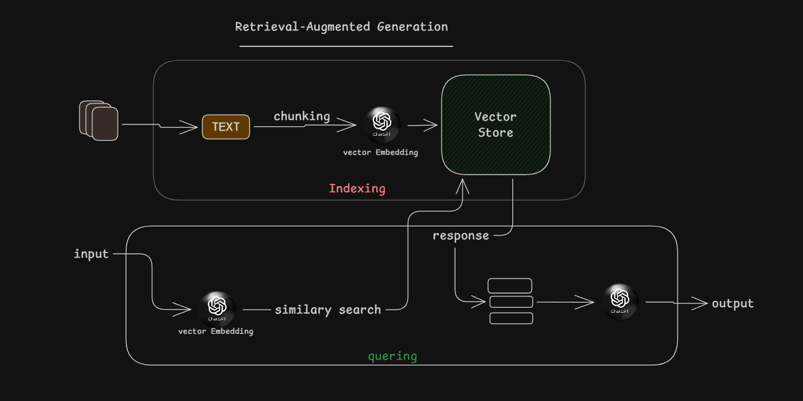

# Simple RAG Application

A simple Retrieval-Augmented Generation (RAG) application for indexing and querying PDF files.

## Technologies

- **Gemini**
- **Qdrant**
- **LangChain**

## Workflow



## Run the Application

1. Install the dependencies:
  ```bash
  npm install
  ```
2. Start the Docker services:
  ```bash
  docker compose up
  ```
3. Build the application:
  ```bash
  npm run build
  ```
4. Index the PDF files:
  ```bash
  npm run indexing
  ```
5. Query the indexed documents:
  ```bash
  npm run query
  ```
